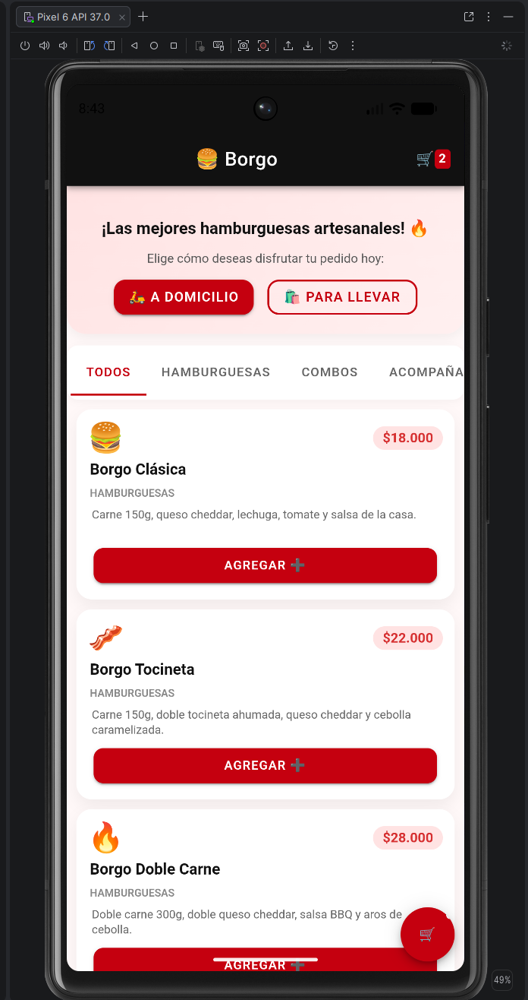

# 🍔 Borgo - App Móvil de Pedidos (Ionic + Angular + Capacitor)


**Borgo** es una aplicación móvil moderna, ligera y responsiva para consultar y realizar pedidos en una hamburguesería artesanal. Construida utilizando **Ionic Framework 9**, **Angular 22 (Standalone Components)** y **Capacitor 8** para su empaquetado nativo en la plataforma Android.

---

## 📱 Vista Previa

| Interfaz de Menú e Interacción |
| :---: |
|  |

---

## ✨ Características Principales

- **Menú Sencillo y Visual**: Presentación clara de productos con iconos emoji, descripciones breves y precios formateados en pesos colombianos (`$15.000`, `$6.000`, `$4.000`).
- **Interacción en Tiempo Real**: Incremento y decremento intuitivo (`+` / `-`) con actualización inmediata de contadores.
- **Resumen Automático del Pedido**: Generación automática de una tarjeta de resumen (`ion-card`) que calcula el total de productos seleccionados y el monto a pagar.
- **Diseño Mobile-First**: Interfaz optimizada para pantallas táctiles de dispositivos Android, utilizando componentes nativos de Ionic (`ion-header`, `ion-toolbar`, `ion-list`, `ion-item`, `ion-button`).

---

## 🛠️ Tecnologías y Librerías

| Tecnología | Versión | Descripción |
| :--- | :--- | :--- |
| **Ionic Framework** | `^9.0.0` | Biblioteca de componentes UI híbridos y nativos. |
| **Angular** | `^22.2.3` | Framework principal para lógica y enlace de datos (Standalone Components). |
| **Capacitor** | `^8.6.0` | Runtime nativo para ejecutar código web en Android sin necesidad de Cordova. |
| **TypeScript** | `~6.0.0` | Lenguaje de programación tipado para desarrollo seguro y estructurado. |
| **SCSS / CSS3** | — | Hojas de estilo personalizadas para el tema visual de Borgo. |

---

## 📋 Proceso de Realización del Proyecto (Paso a Paso)

El desarrollo del proyecto se llevó a cabo siguiendo los siguientes pasos:

### 1. Inicialización y Configuración
- Se generó el proyecto base con **Ionic CLI** adoptando el modelo de **Angular Standalone Components**.
- Se integró **Capacitor** en el proyecto ejecutando `npx cap init` y especificando el paquete (`co.edu.usco.appnativa`) y el directorio de salida web (`www`).

### 2. Desarrollo del Componente Principal (`src/app/home`)
- **[home.page.ts](file:///C:/Users/ESTUDIANTES/Documents/Borgo-borgo/src/app/home/home.page.ts)**: Se definieron las interfaces y arreglos de datos del menú, junto con los métodos de manipulación de estado (`addItem`, `removeItem`, `getTotalItems`, `getTotalPrice`).
- **[home.page.html](file:///C:/Users/ESTUDIANTES/Documents/Borgo-borgo/src/app/home/home.page.html)**: Se maquetó la vista estructurada con encabezado nativo `ion-header`, lista interactiva `ion-list` y la tarjeta reactiva de totales `ion-card`.
- **[home.page.scss](file:///C:/Users/ESTUDIANTES/Documents/Borgo-borgo/src/app/home/home.page.scss)**: Se aplicaron estilos para bordes redondeados, tipografía y distribución flexbox.

### 3. Configuración de la Plataforma Nativa Android
- Se agregó el proyecto nativo mediante el comando:
  ```bash
  npx cap add android
  ```
- Se configuraron los recursos nativos en `android/app/src/main/` (manifest, íconos y splash screen).

### 4. Compilación y Sincronización
- Se compiló el paquete web optimizado:
  ```bash
  npm run build
  ```
- Se copió y sincronizó el bundle en los activos del proyecto Android (`android/app/src/main/assets/public`):
  ```bash
  npx cap sync android
  ```

---

## 📂 Estructura del Proyecto

```text
Borgo-borgo/
├── android/                   # Proyecto nativo de Android (Gradle)
│   └── app/src/main/assets/   # Bundle de activos web sincronizados por Capacitor
├── capturas/                  # Imágenes de muestra de la aplicación
├── src/
│   ├── app/
│   │   ├── home/              # Página principal (Menú e Interacción)
│   │   │   ├── home.page.html # Vista HTML con componentes Ionic
│   │   │   ├── home.page.ts   # Lógica Angular Standalone
│   │   │   └── home.page.scss # Estilos SCSS de la página
│   │   ├── app.component.ts   # Componente raíz
│   │   └── app.routes.ts      # Enrutamiento principal
│   ├── assets/                # Imágenes y recursos estáticos
│   ├── global.scss            # Estilos globales y paleta de colores
│   └── main.ts                # Punto de entrada de Angular
├── www/                       # Directorio de salida del build web
├── capacitor.config.json      # Configuración de Capacitor
├── ionic.config.json          # Configuración del CLI de Ionic
├── package.json               # Dependencias y scripts del proyecto
└── README.md                  # Documentación del proyecto
```

---

## 🚀 Guía de Instalación, Compilación y Ejecución

### Requisitos Previos
- **Node.js**: Versión 18+ instalada.
- **Android Studio**: Con SDK de Android (API 24+) y Gradle.
- **Ionic CLI**: Instalar globalmente con `npm install -g @ionic/cli` (opcional).

### Pasos para Ejecutar

1. **Clonar e instalar dependencias**:
   ```bash
   npm install
   ```

2. **Compilar la aplicación web y sincronizar con Android**:
   ```bash
   npm run build
   npx cap sync android
   ```

3. **Abrir en Android Studio**:
   ```bash
   npx cap open android
   ```
   *O abre la carpeta `android/` directamente desde Android Studio.*

4. **Ejecutar en Emulador o Dispositivo Físico**:
   - En Android Studio, selecciona tu dispositivo emulado o físico.
   - Haz clic en el botón **Run (▶)** o presiona `Shift + F10`.

---

## 📌 Enlaces a Archivos Clave

- 📄 [home.page.html](file:///C:/Users/ESTUDIANTES/Documents/Borgo-borgo/src/app/home/home.page.html): Vista principal con componentes Ionic.
- ⚙️ [home.page.ts](file:///C:/Users/ESTUDIANTES/Documents/Borgo-borgo/src/app/home/home.page.ts): Lógica del menú y estado de la aplicación.
- 🎨 [home.page.scss](file:///C:/Users/ESTUDIANTES/Documents/Borgo-borgo/src/app/home/home.page.scss): Estilos CSS del componente.
- ⚙️ [capacitor.config.json](file:///C:/Users/ESTUDIANTES/Documents/Borgo-borgo/capacitor.config.json): Configuración de Capacitor.
